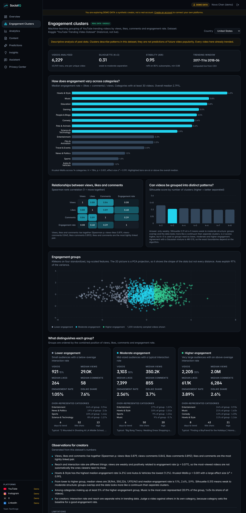
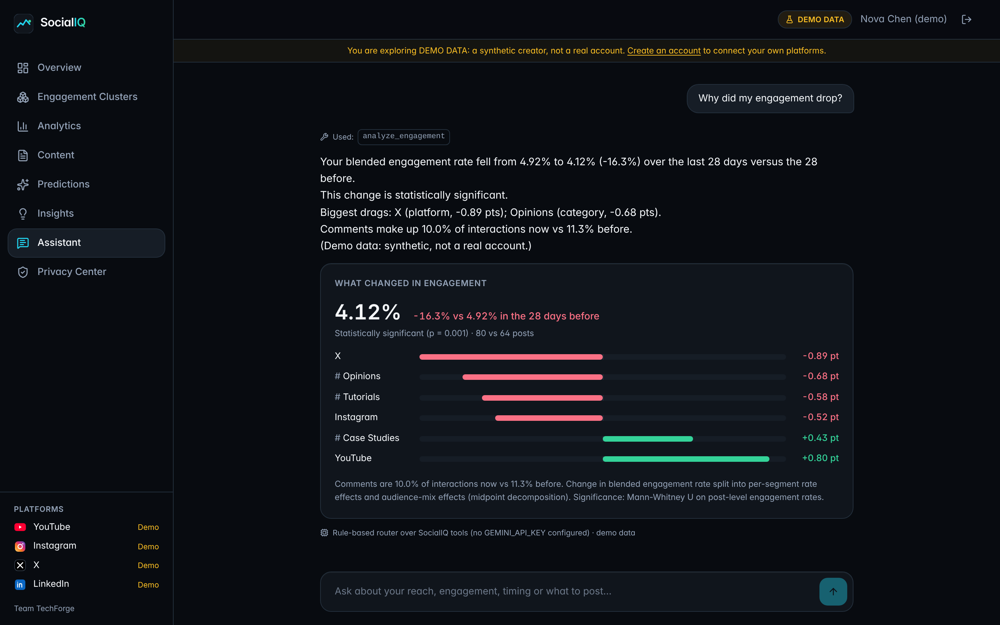
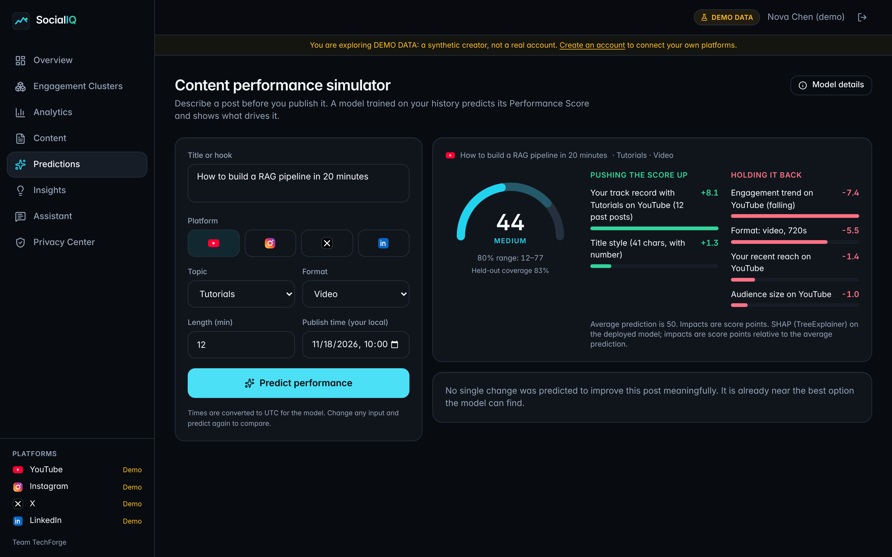
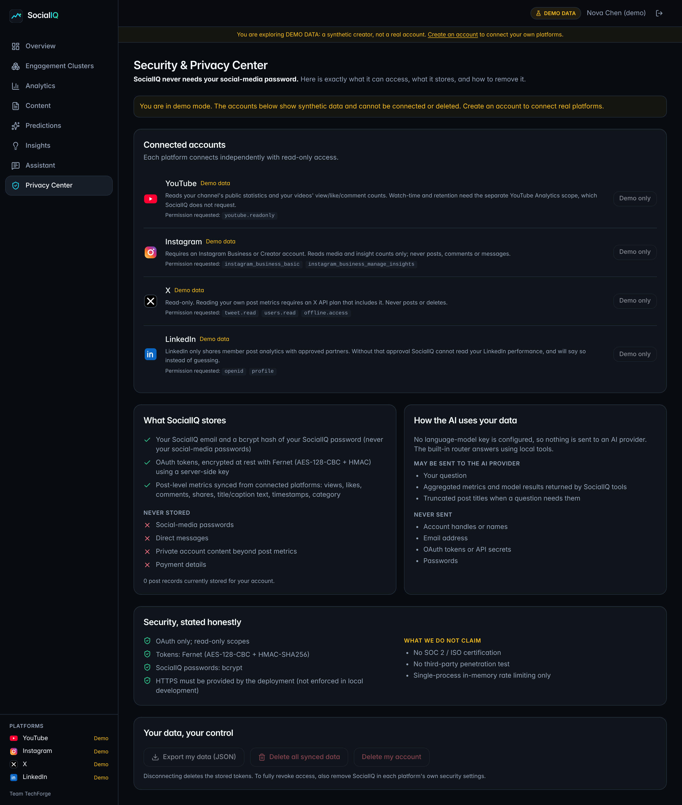

# SocialIQ

**Your social presence. One intelligent view.**

**Team TechForge**

   

SocialIQ is a social-media intelligence platform. Its core is a **machine-learning analysis of YouTube trending-video engagement**: videos are clustered into lower, moderate and higher engagement groups from views, likes, comments and engagement rate, and each group is explained. Around that core it adds cross-platform creator analytics, an explainable performance simulator, and an AI assistant **powered by Google Gemini** that answers from real analytics tools.



## Problem statement: Social Media / YouTube Engagement Analysis

| Brief requirement | Where it is met |
|---|---|
| Analyse YouTube trending-video data | Kaggle *YouTube Trending Video Dataset*, 10 countries, one row per video, exclusions counted ([method](docs/TRENDING_ANALYSIS.md)) |
| Clustering algorithm on engagement measures (views, likes, comments, engagement rate) | KMeans on those four measures, `k = 3`, plus Gaussian-mixture cross-check and stability test (`backend/app/ml/clustering.py`) |
| Scale features appropriately | `log1p` for the heavy tail, then `StandardScaler` |
| Interpret clusters as lower / moderate / higher engagement | Groups ordered by standardised centroid and named accordingly; profile cards with medians and traits |
| *How does engagement vary across categories?* | Category engagement chart with Kruskal-Wallis test and effect size |
| *What relationships exist between views, likes and comments?* | Spearman correlation matrix |
| *Can videos be grouped into distinct patterns?* | Silhouette for k = 2..8. Honest answer: only weakly (silhouette 0.313, US) |
| *What distinguishes the groups?* | Medians, dislike share, days to trend, title length, tags, category lift per group |
| *What can creators take from it?* | Data-generated observations, with limitations stated beside them |
| Historical data, not a live feed; not predictions | Banner on the page, limitations list, and wording throughout |

Open it in the app: **Engagement Clusters** (`/app/clusters`).

### Result (United States, 6,229 videos)

| Group | Videos | Median views | Median engagement rate |
|---|---|---|---|
| Lower engagement | 921 | 28,964 | 1.1% |
| Moderate engagement | 3,103 | 350,226 | 2.6% |
| Higher engagement | 2,205 | 1,970,963 | 3.9% |

Views, likes and comments move together (Spearman ρ 0.85 to 0.89) while engagement *rate* is nearly independent of views (ρ 0.077). Category matters (ε² 0.191). The groups are stable across subsamples (ARI 0.948) but overlap: silhouette 0.313 says this is closer to a continuum than to separate clusters, and the app says so. Results for all ten countries are in [docs/TRENDING_ANALYSIS.md](docs/TRENDING_ANALYSIS.md).

## Also in SocialIQ

- **Gemini assistant.** Google Gemini chooses among 13 SocialIQ tools (summary, platform comparison, top content, engagement analysis, best publish time, categories, anomalies, prediction, creator profile, content strategy and more); SocialIQ executes them and renders real results as cards. Gemini never produces analytics itself. With no `GEMINI_API_KEY`, or if Gemini fails, times out or answers without using a tool, a deterministic router calls the same tools and the UI says which mode answered and why. See [docs/ASSISTANT_GEMINI.md](docs/ASSISTANT_GEMINI.md).
- **Cross-platform analytics** (YouTube, Instagram, X, LinkedIn) through one normalised Content schema and per-platform adapters; demo mode with clearly labelled synthetic data.
- **Why did it change?** Engagement change decomposed into rate vs mix effects with a significance test; robust anomaly detection.
- **Content performance simulator.** Leakage-safe ML (RandomForest / GradientBoosting / XGBoost chosen by time-series CV), conformal 80% interval, SHAP explanations, what-if recommendations, and an honest Model Card.
- **Security & Privacy Center.** Read-only OAuth scopes, encrypted tokens, disconnect / export / delete, and a plain statement of what the AI receives.

| Assistant | Simulator | Privacy |
|---|---|---|
|  |  |  |

## Quick start (no credentials needed)

```bash
make install
make dev-backend      # terminal 1: http://localhost:8000
make dev-frontend     # terminal 2: http://localhost:5173
```

Open http://localhost:5173, choose **Open the clustering analysis** or **Explore the live demo**. The clustering results are served from committed snapshots, so the Kaggle CSVs are not needed to run the app. To recompute from the raw data, see below. One container: `docker compose up --build` then http://localhost:8000 (Docker build not yet tested by the authors).

### Recompute from the Kaggle CSVs

Download the [dataset](https://www.kaggle.com/datasets/datasnaek/youtube-new), put the `*videos.csv` files in `backend/data/kaggle_youtube/`, then:

```bash
make trending         # rebuilds snapshots for every country found
```

With the CSVs present the app computes live and the page shows "computed live from CSV".

## Configuration

Copy `backend/.env.example` to `backend/.env`. Everything is optional.

| Variable | Purpose |
|---|---|
| `GEMINI_API_KEY` | Enables the Gemini assistant (server-side only). Empty = rule-based router. Create one at https://aistudio.google.com/apikey |
| `GEMINI_MODEL` | Default `gemini-3.8-flash`; any Gemini model with function calling |
| `LLM_TIMEOUT_SECONDS`, `LLM_TOTAL_BUDGET_SECONDS` | Per-request and per-question limits before falling back |
| `YT_TRENDING_DIR` | Folder with the Kaggle CSVs (default `backend/data/kaggle_youtube`) |
| `GOOGLE_CLIENT_ID`, `GOOGLE_CLIENT_SECRET` | YouTube OAuth for your own channel ([guide](docs/YOUTUBE_SETUP.md)) |
| `INSTAGRAM_*`, `X_*`, `LINKEDIN_*` | Other platform OAuth credentials |
| `JWT_SECRET`, `TOKEN_ENCRYPTION_KEY` | Set explicitly in production |
| `DATABASE_URL` | SQLite by default; PostgreSQL URL supported |

`python scripts/doctor.py` shows what is configured; `python scripts/doctor.py --live` makes a real Gemini call and a function-calling probe.

## Project structure

```
backend/
  app/ml/clustering.py        engagement clustering (the brief)
  app/ml/snapshots/           pre-computed results for 10 countries + category map
  app/ml/pipeline.py          creator performance simulator (ML, SHAP, conformal)
  app/services/trending.py    Kaggle loader and snapshot/raw resolution
  app/services/llm/           provider-agnostic LLM layer (Gemini)
  app/services/assistant*.py  13 tools + assistant (LLM mode and rule-based mode)
  app/integrations/           YouTube / Instagram / X / LinkedIn adapters
  app/api/                    thin routers (auth, connect, data, research, assistant, privacy)
  tests/                      35 tests, no credentials needed
frontend/src/pages/Clusters.tsx   the clustering page; other pages alongside
docs/                          analysis, architecture, ML, security, API, setup guides, screenshots
scripts/                       doctor.py, build_trending_snapshots.py
```

## Testing

`make test` (35 backend tests; Google and Gemini are mocked), `make typecheck`, `make build`, and `make e2e` (browser checks: 10-step judge walkthrough and the clustering page, including mobile layout). CI runs tests, typecheck and build on every push.

## Documentation

[Trending analysis](docs/TRENDING_ANALYSIS.md) · [Architecture](docs/ARCHITECTURE.md) · [ML](docs/ML.md) · [Security](docs/SECURITY.md) · [API](docs/API.md) · [Gemini assistant](docs/ASSISTANT_GEMINI.md) · [YouTube setup](docs/YOUTUBE_SETUP.md) · [Demo script](docs/DEMO_SCRIPT.md)

## Honest limitations

- **Clustering.** The data is historical (Nov 2017 to Jun 2018) and every video trended, so findings do not describe YouTube overall. Silhouette is 0.30 to 0.40 in every country: the three groups are a convenient partition of a continuum. A Gaussian mixture agrees little with KMeans (ARI 0.097 in the US), so exact boundaries depend on the algorithm. In some countries (for example India) the groups are not ordered the same way on reach and on rate; the page flags it.
- **Gemini.** Real Gemini tool calling has **not been verified** by the authors: it was tested against a mock Gemini server using the real SDK. Run `python scripts/doctor.py --live` with your key. The default model name is unverified live.
- **Platform OAuth.** YouTube OAuth is tested against a mocked Google; Instagram and X need credentials; LinkedIn analytics need partner approval and are not fabricated.
- **Simulator.** Its metrics are on synthetic demo data: it ranks posts better than chance but does not beat the baseline on absolute error ([ML](docs/ML.md)).
- "What should I post next" takes about 5 s uncached. The Docker image build is untested. The raw Kaggle CSVs are not in the repository.

## Team

**TechForge**. MIT licensed, see [LICENSE](LICENSE).
