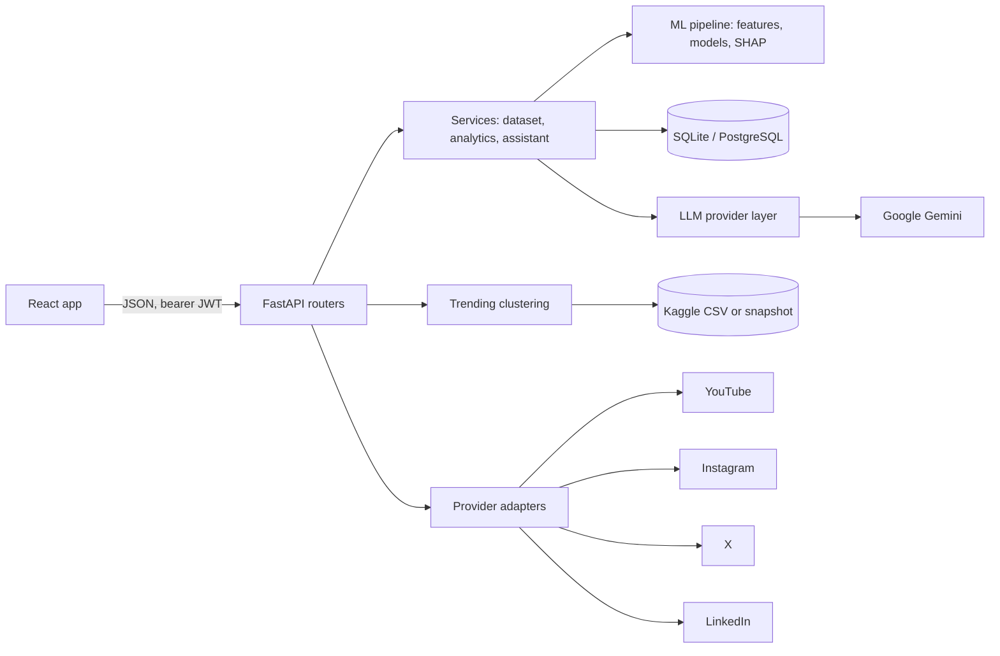

# Architecture

## Layers
| Layer | Responsibility |
|---|---|
| `app/api` | Thin routers: auth, connect (OAuth), data/analytics/ML, privacy, assistant |
| `app/services` | `dataset` (workspace loading, demo vs live), `analytics` (summary, decomposition, anomalies, timing, cross-platform, profile), `assistant` + `assistant_tools` (13 tools), `llm/` (provider layer) |
| `app/ml` | `clustering.py` (YouTube trending engagement clusters) and `pipeline.py` (creator performance simulator: leakage-safe features, model selection, conformal intervals, SHAP, what-if) |
| `app/services/trending.py` | Resolves a country to raw Kaggle CSV (computed live) or a committed snapshot |
| `app/integrations` | One adapter per platform, all emitting the unified Content schema; unavailable platforms raise `ProviderUnavailable` instead of fabricating data |
| `app/security` | bcrypt password hashing, JWT, Fernet token encryption |

## Unified Content schema
Every platform is normalised to one row type: platform, external id, title, content type, category, published time, duration, views, likes, comments, shares, followers snapshot. All analytics and ML read only this schema, so adding a platform means writing one adapter.

## Demo vs live
A workspace is `demo`, `live` or `empty`. Demo data is synthetic, generated deterministically, and labelled `DEMO DATA` in every payload and in the UI header. Live workspaces contain only what a connected platform returned.

## Assistant
The model never computes analytics. It selects from 13 tools; SocialIQ executes them against the workspace and returns structured results that render as UI cards. Without a key, or if Gemini fails, times out or answers without calling any tool, a deterministic router calls the same tools and the response states which mode produced it. See [ASSISTANT_GEMINI.md](ASSISTANT_GEMINI.md).

## Performance
Heavy analytics are memoised per workspace key and the demo model is warmed on startup. Uncached `generate_content_strategy` takes about 5 s because it scores candidate ideas with the ML model.
